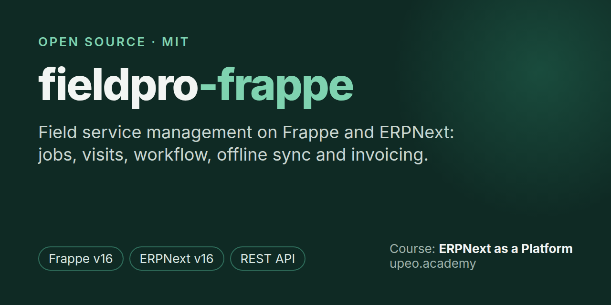
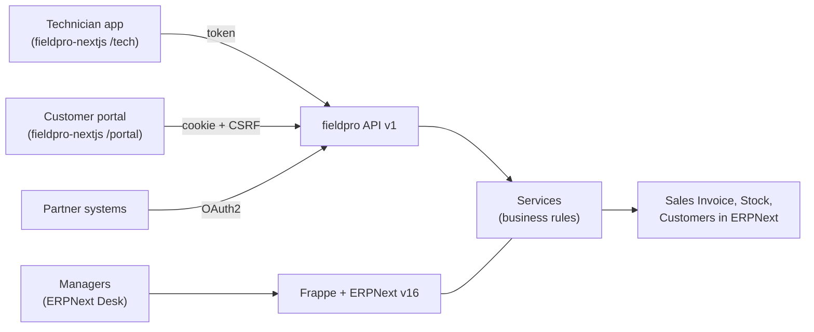

# fieldpro-frappe: field service management on Frappe and ERPNext



[](https://github.com/karani-gk/fieldpro-frappe/actions/workflows/ci.yml)
[](license.txt)


[](https://www.upeo.academy/courses/erpnext-as-platform-course)

**fieldpro-frappe** is an open-source field service management app for
[Frappe](https://frappe.io/framework) and [ERPNext](https://erpnext.com). It takes a service job
from booking to invoice: customers book work and approve it, technicians record visits, parts,
photos and signatures (even with no signal), managers assign and approve in their own Vue app (or ERPNext Desk), and
accounts gets a draft Sales Invoice for every finished job.

It is the backend for three clients: a technician app, a customer portal
([fieldpro-nextjs](https://github.com/karani-gk/fieldpro-nextjs)) and ERPNext Desk for managers.
It is also the code you build, lesson by lesson, in UPEO Academy's course
**[ERPNext as a Platform](https://www.upeo.academy/courses/erpnext-as-platform-course)**.

## Contents

- [Features](#features)
- [How it fits together](#how-it-fits-together)
- [Quick start](#quick-start)
- [Demo sign-ins](#demo-sign-ins)
- [Project structure](#project-structure)
- [Course map](#course-map)
- [Tests](#tests)
- [FAQ](#faq)
- [License](#license)

## Features

- **Service jobs and visits:** book, assign, schedule and track jobs; record each visit's hours,
  parts used (from the technician's own warehouse), photos and notes.
- **Workflow as a state machine:** a Frappe Workflow drives each job; small jobs go straight to
  customer sign-off, large ones to manager approval first.
- **Row-level security:** a technician sees only their jobs, a customer only their company's.
- **Versioned REST API (`/api/v1`):** one error format, typed response shapes and cursor
  pagination. See the [API contract](docs/API.md).
- **Three ways to sign in:** technicians use a password or a one-time code by email or SMS, and
  receive an API token; customers use a session cookie with CSRF; partner systems use OAuth2. See
  [AUTH.md](docs/AUTH.md).
- **Offline sync:** the technician app queues work with no signal, and the server applies each
  batch once, however often it is sent.
- **Realtime and push:** live job updates over socket.io and Firebase web push.
- **Automatic invoicing:** a background job turns every finished job into a draft ERPNext Sales
  Invoice, with an hourly sweep as a safety net.
- **Webhooks in and out:** signed callbacks from SMS and payment providers; signed deliveries to
  partner systems, with retries.
- **A manager's app in Vue.js (`/manage`):** a dashboard, a drag-and-drop job board, a job list
  and job screen (assign, approve, send back, cancel, edit), technician workload, booking by
  phone, customers (open jobs, what they owe, book from the row), invoices (draft, submit, PDF,
  and finished jobs still waiting for one) and the everyday settings. It uses the Desk session
  and the same rules as Desk.
- **Documents and reports:** a Job Card PDF print format and a Technician Performance report.

## How it fits together



Endpoints stay thin. Every business rule lives in `fieldpro/services/`, so the API, Desk and
background jobs all follow the same rules.

## Quick start

**Everything in one download:** [fieldpro-course](https://github.com/karani-gk/fieldpro-course)
holds this app, the Next.js app and scripts that set up both. Clone it to start from nothing.

**Requirements:** Frappe and ERPNext v16, Python 3.14, MariaDB, Redis, Node.js 22.6 or newer, and
[bench](https://github.com/frappe/bench).

```bash
bench get-app https://github.com/karani-gk/fieldpro-frappe
bench --site <site> install-app fieldpro
bench --site <site> fieldpro-activate <code>  # once: the access code from your course email
bench --site <site> fieldpro-demo             # optional: demo company, stock, people and jobs
bench --site <site> run-tests --app fieldpro  # needs the demo data
```

**Activation, once per installation.** Nobody can sign in until the installation is activated
with the access code emailed to learners of
[ERPNext as a Platform](https://www.upeo.academy/courses/erpnext-as-platform-course). Use the
command above or open `/activate` on the site. The code is checked offline against a public key,
so no internet connection is needed.

`bench get-app` puts the app in `apps/fieldpro` (the app's name), whatever the repository is
called. For the screens, set up [fieldpro-nextjs](https://github.com/karani-gk/fieldpro-nextjs)
next to it.

## Demo sign-ins

`bench fieldpro-demo` creates Baridi Services Ltd. The password for every demo user is
`fieldpro-demo`.

| Who | Where | Sign in |
|---|---|---|
| Technician (Achieng, Otieno, Wanjiru) | technician app `/tech` | `achieng@fieldpro.test` or `0700 100001` (`…002`, `…003`) with the password, or a one-time code |
| Customer (Wanjiku Clinic and two more) | customer portal `/portal` | `clinic@fieldpro.test`, `apartments@fieldpro.test`, `supermarket@fieldpro.test` |
| Manager | The Vue app at `/manage` (Desk sends field managers there; **Switch to Desk** in the app goes back) | `manager@fieldpro.test` |

On a local machine nothing is sent: with no outgoing Email Account or SMS gateway, the sign-in
code is saved in Desk under **SMS Log**. On a real site, **Fieldpro Settings > Send Sign-in Codes
By** chooses Email (the default) or SMS.

## Project structure

| Path | What is there |
|---|---|
| `fieldpro/fieldpro/doctype/` | Technician, Service Job, Job Visit (+ Parts Used), Device Token, Partner Delivery, Callback Event, Fieldpro Settings |
| `fieldpro/fixtures/` | Roles, the Service Job workflow (states, actions, transitions), custom fields on Sales Invoice, Desk notifications |
| `fieldpro/permissions.py`, `access.py` | Row-level security: a technician sees only their jobs, a customer only their company's |
| `fieldpro/services/` | All business rules. Endpoints, controllers and background jobs call these |
| `fieldpro/api/` | The versioned API: `api/v1/*.py` endpoints, `endpoint.py` (one decorator), `errors.py` (one error format), `shapes.py` (response shapes), `pagination.py` (cursors) |
| `fieldpro/tasks.py`, `hooks.py` | Scheduled work and wiring |
| `fieldpro/fieldpro/print_format/job_card/` | The Job Card PDF |
| `fieldpro/fieldpro/report/technician_performance/` | Jobs and hours by technician in Desk |
| `fieldpro/desktop_icon/`, `workspace_sidebar/`, `fieldpro/workspace/`, `fieldpro/number_card/`, `fieldpro/dashboard_chart/` | The Field Service desk: its icon, sidebar, workspace, number cards and charts, synced on install and migrate. `services/job_board.py` adds the Job Board (Kanban) |
| `frontend/`, `fieldpro/www/manage.py`, `services/dispatch.py`, `invoice_desk.py`, `settings_desk.py`, `customer_directory.py`, `api/v1/manage.py` | The manager's Vue app: Vue 3 + Vite source, the page that serves it at `/manage`, and its API. `bench build` builds it into `fieldpro/public/manage/` |
| `fieldpro/demo.py`, `commands.py` | `bench fieldpro-demo` |
| `fieldpro/tests/` | Permission, workflow, sync, invoicing, webhook, sign-in and API-contract tests |
| `docs/` | [API.md](docs/API.md) (the contract), [AUTH.md](docs/AUTH.md) (signing in, per client), `bruno/` (a request collection) |

## Course map

Each lesson of [ERPNext as a Platform](https://www.upeo.academy/courses/erpnext-as-platform-course)
builds one part of this app. Read along here:

| Lesson | Read |
|---|---|
| Data model for API consumers | the DocType JSON files; `service_job.py` `on_doctype_update` (indexes) |
| Extending ERPNext from your app | `fixtures/custom_field.json`, `patches/v1_0/`, `services/invoicing.py` |
| A versioned API | `api/endpoint.py`, `api/errors.py`, `api/shapes.py`, `api/pagination.py`, `api/v1/` |
| Authentication | `services/otp.py`, `api/v1/auth.py`, `services/activation.py`, `docs/AUTH.md` |
| Permissions as API security | `access.py`, `permissions.py`, `services/job_rules.py` (edit guard) |
| Jobs, visits and parts | `services/jobs.py`, `services/visits.py`, `services/visit_rules.py` |
| Workflows as state machines | `fixtures/workflow.json`, `services/job_flow.py`, `services/job_rules.py` |
| Realtime and push | `services/realtime.py`, `services/push.py`, `fixtures/notification.json` |
| Background jobs | `services/job_events.py`, `services/invoicing.py`, `tasks.py` |
| Webhooks in and out | `services/partner_webhooks.py`, `services/callbacks.py`, `api/v1/webhooks.py` |
| Photos and PDFs | `services/visits.py` (`add_photo`), `services/job_flow.py` (`SignatureStore`), `api/v1/files.py`, the Job Card print format, `jinja.py` |
| Reports | `services/reports.py`, the Technician Performance report, `api/v1/reports.py` |
| Offline sync | `services/sync.py`, `api/v1/sync.py` |
| Testing and versioning | `tests/`, `api/v1/__init__.py`, `.github/workflows/ci.yml` |

## Tests

```bash
bench --site <site> run-tests --app fieldpro
cd apps/fieldpro && ruff check fieldpro && ruff format --check fieldpro
cd apps/fieldpro/frontend && yarn test      # the manager app's logic (Vitest)
```

Working on the manager app: `cd apps/fieldpro/frontend && yarn dev` rebuilds on every save;
reload `/manage` to see the change.

GitHub Actions runs the tests on Frappe v16 for every push to `main` and every pull request.

## FAQ

**What is fieldpro-frappe?**
An open-source Frappe app that adds field service management to ERPNext: service jobs,
technician visits, parts, signatures, approvals, offline sync and automatic invoicing, behind a
versioned REST API.

**Which versions does it support?**
Frappe and ERPNext v16, on Python 3.14.

**Is it free?**
Yes. The code is MIT-licensed. The video course that teaches how it is built,
[ERPNext as a Platform](https://www.upeo.academy/courses/erpnext-as-platform-course), is sold by
UPEO Academy.

**Why does it ask for an access code?**
The code is free to read and learn from, and the course pays for its making. Each installation
is activated once with the access code that course learners receive by email. See
[docs/AUTH.md](docs/AUTH.md#activation-once-per-installation).

**Do I need an SMS gateway?**
No. Technicians get their sign-in code by email by default, which works in any country. SMS
through Frappe's SMS Settings is an option.

**Can I use it with Flutter or React Native instead of Next.js?**
Yes. The technician app follows the mobile pattern (one-time code, API token, outbox and cursor
sync), so any mobile client can use the same API. See [docs/API.md](docs/API.md).

**Does it change ERPNext's own code?**
No. It extends ERPNext through custom fields, fixtures, hooks and patches, so ERPNext updates
stay safe.

## Related

- [fieldpro-nextjs](https://github.com/karani-gk/fieldpro-nextjs): the technician app and
  customer portal (Next.js, TypeScript).
- [ERPNext as a Platform](https://www.upeo.academy/courses/erpnext-as-platform-course): the
  course, from UPEO Academy.

## License

[MIT](license.txt), © 2026 Upeosoft.
